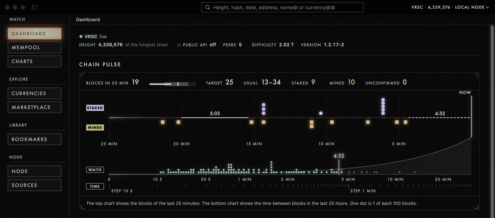
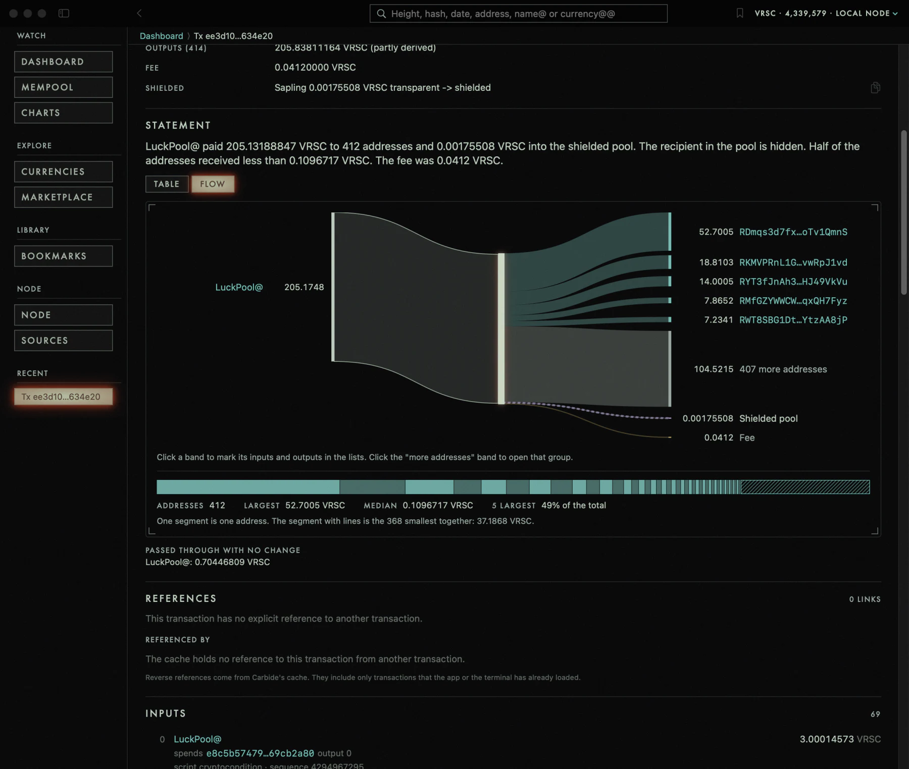
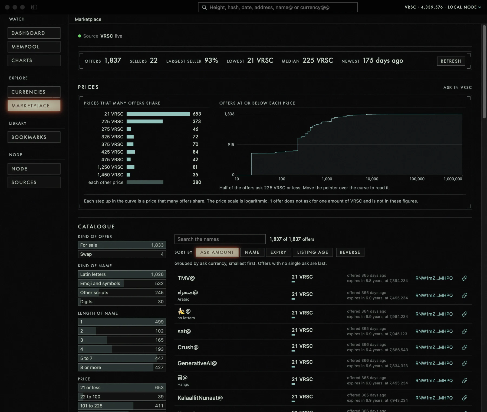
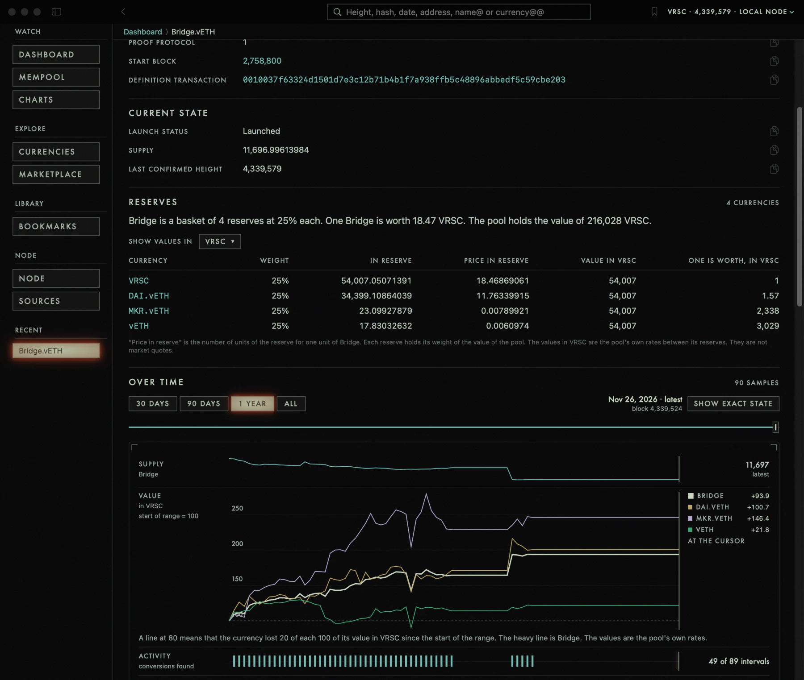
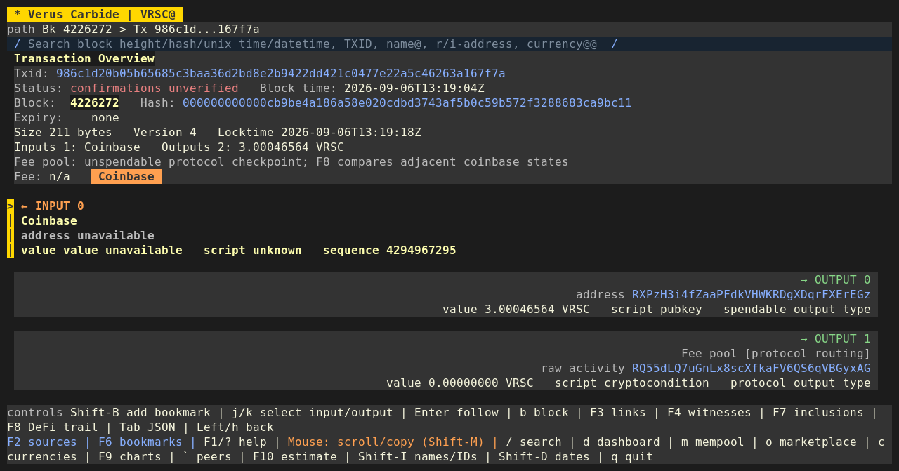
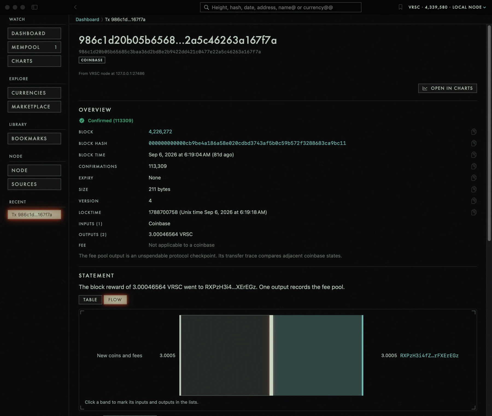
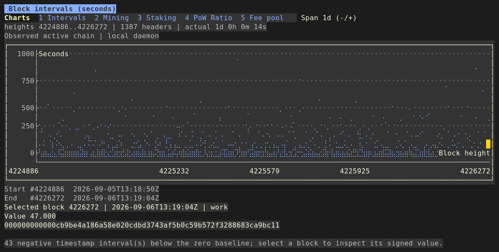
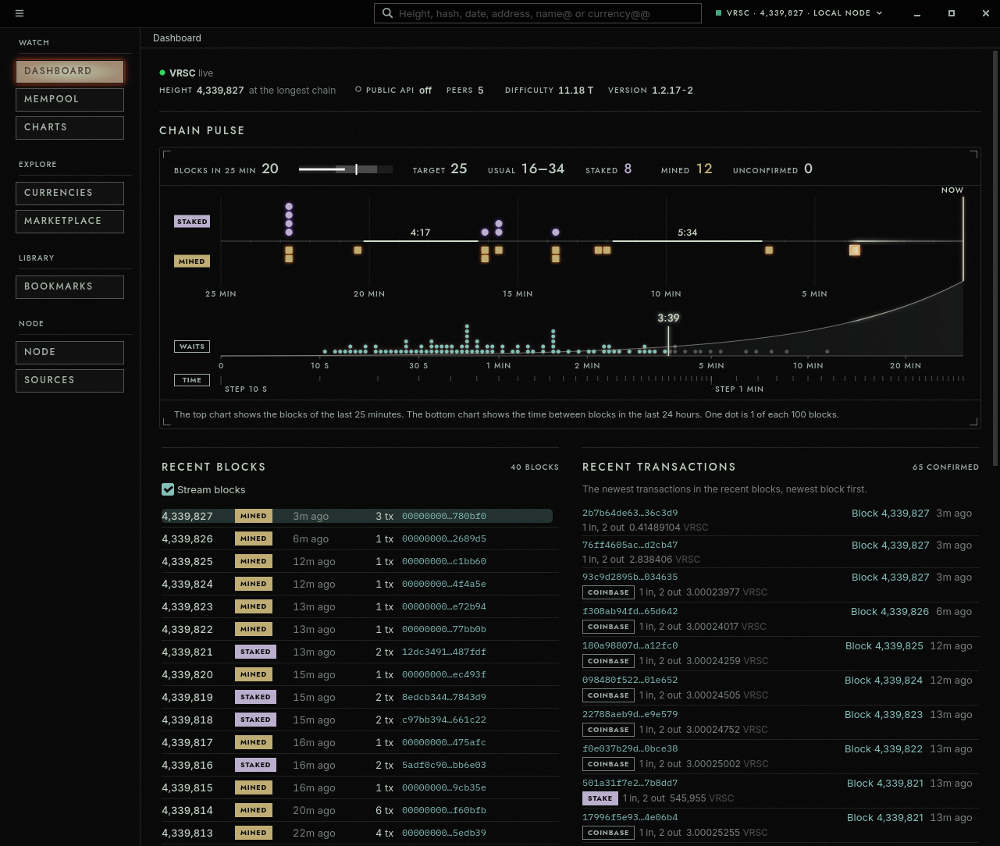
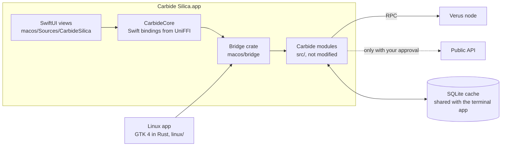

<h1 align="center">Carbide Silica</h1>

<p align="center">
  A native explorer for Verus and PBaaS chains, for macOS and Linux.<br>
  It shows chain data as charts and diagrams. Each page also gives the exact figures.
</p>

<p align="center">
  
  
  <a href="https://github.com/aelder/CarbideSilica/releases/tag/linux-v0.1.0"></a>
  
  
  
  
  
  
  
</p>

<p align="center">
  <a href="#pages">Pages</a> &nbsp;
  <a href="#comparison-with-the-terminal-app">Comparison</a> &nbsp;
  <a href="#macos">macOS</a> &nbsp;
  <a href="#linux">Linux</a> &nbsp;
  <a href="#keys">Keys</a> &nbsp;
  <a href="#network-requests">Network requests</a> &nbsp;
  <a href="#architecture">Architecture</a> &nbsp;
  <a href="#known-limits">Known limits</a>
</p>



Carbide Silica is a second front end for [Carbide](https://github.com/alexenglish/VerusCarbide), the terminal explorer by [alexenglish](https://github.com/alexenglish). The app compiles Carbide's own source files, so it uses the same RPC client, the same decoding and the same cache as the terminal app. The two apps differ only in the interface.

Carbide Silica has two versions. The macOS version is written in Swift with SwiftUI. The Linux version is written in Rust with GTK 4. The two versions have the same pages, the same functions and the same display.

The app is read-only. It does not read a wallet, and it cannot create, sign or send a transaction.

## Pages

Each picture below is the macOS app with a live VRSC node. No picture is a mock-up. The Linux app has the same pages, and [Linux](#linux) has a picture of it.

### Transaction page

A transaction page starts with a statement in words. Below it, the flow shows each party as a band, and the width of a band is its amount. This payout has 414 outputs. The app shows the five largest and puts the other 407 addresses in one band that you can open.



### Charts page

Block rate, mining difficulty, staking difficulty, staked share and the fee pool share one time axis and one cursor. The block rate has process limits, so a red point is a period outside the usual range. The staked share has the limits of chance. The dot plot at the bottom puts the selected wait among all waits of the range.


### Identity page

Each step is one version of the identity. The lanes show who held the keys, who can revoke, who can recover, and the lock. The Control card then says in words what happens when a key is lost and when a key is stolen.


### Other pages

| | |
|---|---|
|  |  |
| **Marketplace.** 1,837 open offers as a catalogue. One curve shows the number of offers at or below each price. Each filter shows its count. | **Baskets in one unit.** Select a reserve as the unit. The table and the lines then show each reserve in that unit on one scale. |
|  |  |
| **Currencies.** Lamp keys filter by launch state and by option. The default view is the liquidity pools without failed launches. | **Dashboard.** The chain pulse, the recent blocks and the recent confirmed transactions with their tags. |

The app also has the Mempool, Bookmarks, Sources, a Node page with a map of the connected peers, block and address pages, the transfer trace, witnesses, the notarization browser and the raw JSON of each object. [macos/docs/features.md](../macos/docs/features.md) lists each function.

## Comparison with the terminal app

The two apps use one engine. They read the same node, write the same cache file and share one bookmark file and one settings file. You can use the two apps on one computer.

### The same objects in the two apps

The left pictures are from Carbide's own readme. The right pictures show the same transaction and the same identity in this app.

| Terminal | App |
|---|---|
|  |  |
|  |  |
|  |  |

### Advantages of this app

| Subject | Terminal | App |
|---|---|---|
| Transactions | Inputs and outputs as lists | A statement in words, a table of each party's net change, and a flow |
| Large transactions | Each output is a row | Lists above 40 rows show 20 rows first, and the flow groups the small amounts |
| Charts | One measure at a time, selected with the keys 1 to 5 | Five panels on one time axis with one cursor, process limits and limits of chance |
| Block production | A list of recent blocks | The chain pulse: bursts, gaps and the present wait against one day of waits |
| Identity history | Each version as text | All versions as lanes, and the result of a lost key and a stolen key in words |
| Marketplace | A list with four sort orders | The same list, a price curve, shared prices as bars, and filters with counts |
| Peers | A list and a world map of text characters | A drawn map with one line for each peer, and counts by network operator and country |
| Pointer | Scroll, and click to copy | Each row, link, band and chart point reacts to the pointer |
| Finding a command | Help page and footer | Command-K (Ctrl+K on Linux) lists each command and each card of the open page with its key |

### Advantages of the terminal app

| Subject | Terminal | App |
|---|---|---|
| Remote use | Runs on the server beside the node, through SSH and tmux | Runs on a Mac or a Linux desktop. It must reach the node's RPC port from that computer |
| Platforms | Linux. Carbide is tested on Debian 13 | macOS 15 or later, and Linux with GTK 4.14 or later |
| Installation | One `cargo build`, one binary | macOS: Rust and Xcode, a bridge build and a Swift build. No signed download exists. Linux: a `.deb` package or a tarball for x86-64, or a build from source |
| Size and memory | One small binary in a terminal | The macOS app is 31 MB. It used approximately 300 MB of memory on the Dashboard in one measurement. The Linux app was not measured |
| New chain logic | Arrives here first | Arrives after a merge from Carbide, and a new function needs new bridge code |
| Tests of the interface | Terminal tests operate the real screens | The tests cover the bridge and the logic of the Linux app. No test operates the windows |
| PoW Ratio chart | Has it | Does not have it. The staked share panel shows a related measure |
| Diagnostics | `--probe`, `--clipboard-test` and a UI timing log | None of these |
| Text workflow | Select, copy and pipe text with terminal tools | Copy one value at a time, or save the JSON |

### Common to the two apps

- The two apps are read-only. The peer commands are the only requests that change the node, and each one asks for confirmation.
- The two apps use the same RPC client, resolver and decoding, because the app compiles Carbide's source files.
- The two apps share the cache, the bookmark file and the settings file.
- The terminal keys work in the app: `j` and `k` move the cursor, Return opens, Esc goes back, and one letter goes to a place.

### When to use each app

- The node is on a remote server, and you work through SSH. Use the terminal app.
- The node is on your computer, or its RPC port is reachable from your computer, and you want to see a transaction, an identity or a trend as a picture. Use this app.
- If you are not sure, use the two apps. They do not conflict.

## macOS

No download exists for macOS. Build the app from source. You need macOS 15, Xcode with Swift 6, and Rust 1.88 or later.

```sh
git clone https://github.com/aelder/CarbideSilica.git
cd CarbideSilica/macos
./build.sh
open "Carbide Silica.app"
```

`build.sh` builds the Rust bridge, generates the Swift bindings, builds the app and signs it for local use. The first build takes some minutes.

To work on the Swift code in Xcode, run `./build.sh bridge` once, then open `Package.swift`. Run it again each time the Rust side changes.

### Connect to a node

The app reads the RPC settings of the node from the standard macOS location, `~/Library/Application Support/Komodo/VRSC/VRSC.conf`. PBaaS chains are below `~/Library/Application Support/Verus/pbaas`. You can select a different file in Settings.

A computer without a node can use one public API. You turn this on in Settings. The operator of that API can then see the addresses and identities that you open.

### Start-up arguments

The arguments are the same as Carbide's, with one dash or two. They are the same on Linux.

| Argument | Function |
|---|---|
| `-chain=` | The chain to open |
| `-testnet` | Use the testnet |
| `-conf=`, `-datadir=` | The configuration file or the data folder of the node |
| `-rpcconnect=`, `-rpcport=`, `-rpcuser=`, `-rpcpassword=` | RPC settings that replace those of the file |
| `-pollinterval=` | The time between refreshes |
| `-open=` | A block, transaction, address, identity or currency to open at start |

The arguments apply to one run. They do not change the saved settings.

## Linux

The Linux app is in the `linux` folder. It calls the same bridge crate as the macOS app.



### Install

[Release 0.1.0](https://github.com/aelder/CarbideSilica/releases/tag/linux-v0.1.0) has two packages for x86-64.

On Debian 13, use the `.deb` package. apt installs the libraries.

```sh
sudo apt install ./carbide-silica_0.1.0_amd64.deb
```

On other distributions, use the tarball. It installs into `~/.local`.

```sh
tar -xzf carbide-silica-0.1.0-linux-x86_64.tar.gz
./carbide-silica-0.1.0-linux-x86_64/install.sh
```

The tarball does not install libraries. The app needs GTK 4.14 or later, ALSA, fontconfig and the CA certificates of the system. The demo needs Python 3.

### Demo without a node

The packages include a demo. It starts the app with a local RPC server that supplies a synthetic chain of 5,001 blocks. The demo does not need a Verus node. The server listens only on the loopback address.

```sh
carbide-silica-demo --open 5000
```

After a tarball install, the command is `~/.local/bin/carbide-silica-demo`. The Dashboard, the Charts page, the block and transaction pages and the Node page work with the synthetic chain. Other requests give an error. When you close the window, the demo stops its server and removes its settings and its cache.

### Connect to a node

The app reads the RPC settings of the node from `~/.komodo/VRSC/VRSC.conf`. PBaaS chains are below `~/.verus/pbaas`. You can select a different file in Settings.

### Build

The build needs Rust, GTK 4.14 or later, ALSA and fontconfig. On Debian 13:

```sh
sudo apt install build-essential pkg-config libgtk-4-dev libasound2-dev libfontconfig-dev
cargo build --release --locked --manifest-path linux/Cargo.toml
```

`linux/build.sh` and `linux/package.sh` do the build and make the packages in Docker.

### Differences from macOS

- Ctrl replaces Command, and Alt replaces Option. Ctrl+Shift replaces Control-Command.
- The menus are in the menu key at the left of the title bar.
- Jost, Inter and IBM Plex Mono replace Futura, SF Pro and SF Mono. The package has the fonts.

[linux/README.md](../linux/README.md) has all install steps, the keys, the file locations and the known limits of the Linux app.

## Keys

Each function has a menu command and a shortcut. Help > Keyboard Shortcuts lists all of them beside the terminal keys. The table shows the macOS keys. On Linux, use Ctrl for `⌘`, and Ctrl+/ shows the list.

| Key | Function | Terminal key |
|---|---|---|
| `⌘K` | Open the command list | none |
| `⌘F` or `/` | Search | `/` |
| `j` `k` or the arrow keys | Move the cursor through the rows and links of the page | `j` `k` |
| Return | Open the row or link under the cursor | Enter |
| Esc | Go back one page | Esc |
| Tab | Show the raw JSON of the page | Tab |
| `d` `m` `o` `c` | Dashboard, Mempool, Marketplace, Currencies | `d` `m` `o` `c` |
| `n` `p` | Next or previous block, in place | `n` `p` |
| `F8` `F4` `F3` `F7` | Follow a transfer, witnesses, protocol links, block history | `F8` `F4` `F3` `F7` |
| `⇧⌘I` `⇧⌘D` | Names or IDs, dates or heights | `Shift-I` `Shift-D` |

## Network requests

- The app sends RPC requests to your node. With a local node, nothing leaves the computer.
- The public API is off at the start. When the node cannot answer a page that you open, the app asks before it sends that request to the API. The app never sends background requests to an API.
- The peer map uses location data that you install from the Node page. The app downloads it from DB-IP only after you confirm. The app draws the map itself and makes no request to a map service.
- The app has no analytics and no update check.

## Architecture



| Path | Contents |
|---|---|
| `src/desktop_bridge.rs` | The crate root for the bridge. It has Carbide's modules without the terminal interface |
| `macos/bridge/` | The Rust crate with the API for Swift (`src/ffi.rs`, `src/ffi_<area>.rs`) and its tests |
| `macos/Sources/CarbideCore` | The Swift bindings that UniFFI generates. They are not checked in |
| `macos/Sources/CarbideSilica` | The SwiftUI app |
| `macos/design/` | The study behind each picture, as HTML pages |
| `macos/bridge/rust/` | A crate root that gives the bridge to the Linux app as a Rust library, without UniFFI |
| `linux/` | The Linux app, its fonts and sounds, the Docker build and the packaging scripts |
| `tests/synthetic_demo.py`, `tests/synthetic_chain.py` | The demo server and its synthetic chain |

Outside `macos/` and `linux/`, this project adds four files: `src/desktop_bridge.rs`, the two demo files in `tests/`, and this page, `.github/README.md`. It changes three files of Carbide: `README.md` has a section about the Linux build, and `tests/bookmarks_terminal.py` and `tests/charts_terminal.py` take their chain data from `tests/synthetic_chain.py`. A merge from Carbide can have conflicts in these three files. Carbide's own readme is [README.md](../README.md).

Two things need attention after a merge from Carbide:

- `macos/bridge/Cargo.toml` repeats the `[dependencies]` of the root `Cargo.toml`. Copy each dependency change.
- If Carbide adds or removes a module in `src/main.rs`, make the same change in `src/desktop_bridge.rs`.

### Tests

Run the tests from the `macos` folder.

```sh
cargo test --manifest-path bridge/Cargo.toml --lib ffi::
```

323 tests pass at this commit. The live tests send requests to a real node and use their own cache folder:

```sh
CARBIDE_TEST_CONF=<path to the node's .conf> CARBIDE_TEST_API=https://api.verus.services \
  cargo test --manifest-path bridge/Cargo.toml --lib ffi:: -- --ignored --test-threads=1
```

[macos/CONVENTIONS.md](../macos/CONVENTIONS.md) has the rules for the architecture, the tests, the text and the layout.

### Cache

Carbide's cache is an SQLite file. The default location is `~/Library/Caches/verus-carbide` on macOS and `~/.cache/verus-carbide` on Linux. Settings shows its size, can clear it, and can move it to a folder on another disk. The cache has no size limit, because Carbide keeps each block and transaction that you open as evidence. Chart loads do not add to it.

## Known limits

These limits apply to the two versions. [linux/README.md](../linux/README.md#known-limits) has the limits of the Linux app only.

- The app shows one chain at a time. A block or transaction on another chain is text, with a link to change the chain when that chain's node is configured.
- A node for another chain that the app finds on the computer starts in the Disabled state, as in Carbide. A transfer trace into that chain needs the node enabled in Sources.
- Reverse references include only the transactions in Carbide's cache or opened in this run.
- A chart cannot read a newer range from a block on a side branch. The node does not supply it.
- Through a public API, charts load at approximately 10 blocks each second. Use the 2-hour span.
- Requests by address or by authority need the identity index of the node (`-idindex=1`). Without it, the app says so.
- The place and the network operator of a peer need the location data from DB-IP.
- These cases are not verified on live data, because no such data was available: a second PBaaS node for the other notarization view, a block on a side branch, and a tokenized identity.

## Credits and license

- [Carbide](https://github.com/alexenglish/VerusCarbide) by [alexenglish](https://github.com/alexenglish) supplies all chain logic. Carbide Silica adds the macOS interface and the Linux interface.
- Peer locations come from [DB-IP](https://db-ip.com) City Lite and ASN Lite, under CC BY 4.0.
- The interface sounds are under the MIT license. `macos/Resources/Sounds/LICENSE-button-sounds.txt` has the notice.
- The Linux app uses the fonts Jost, Inter and IBM Plex Mono, under the SIL Open Font License 1.1. Their licence files are in `linux/resources/fonts`.

Carbide Silica has the same license as Carbide, the [MIT License](../LICENSE). The software is experimental and has no warranty.
