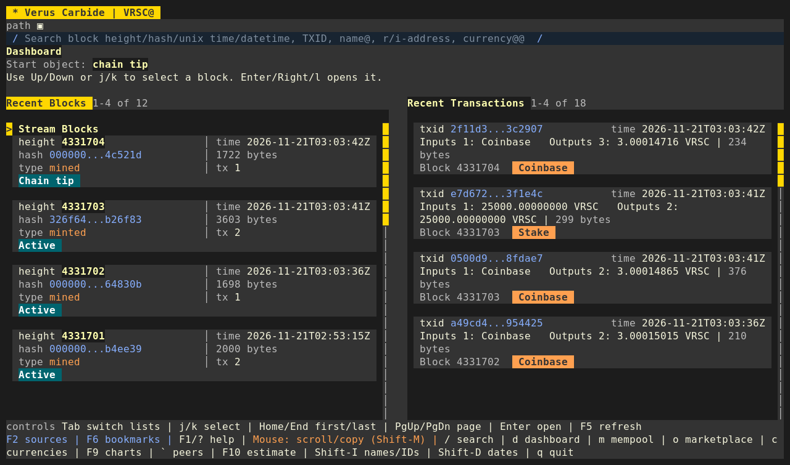
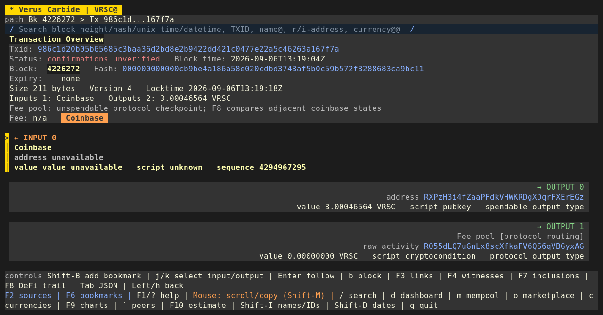
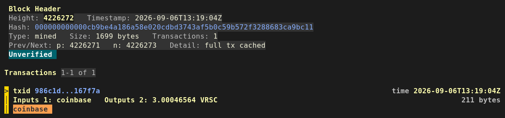
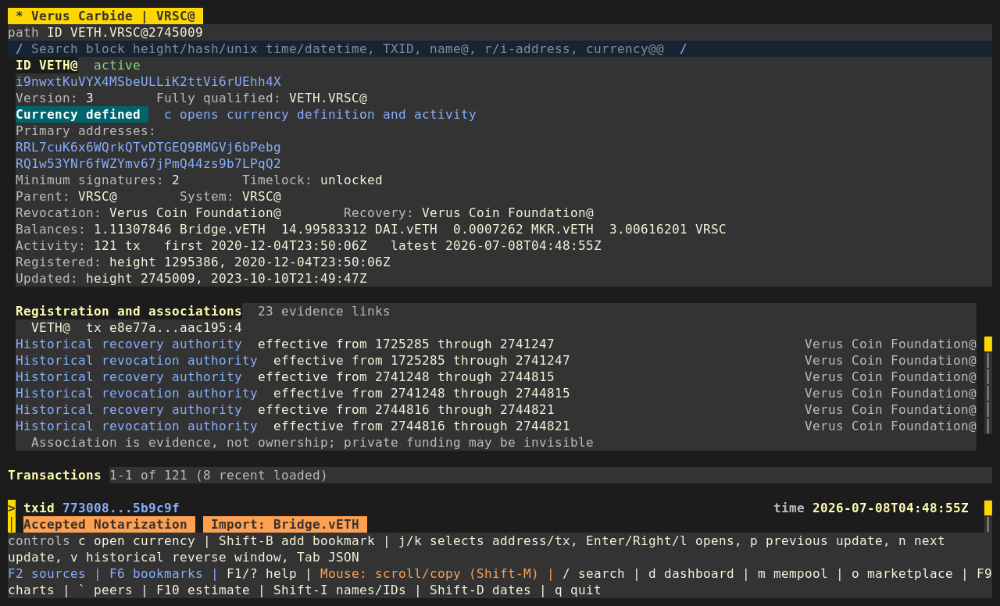
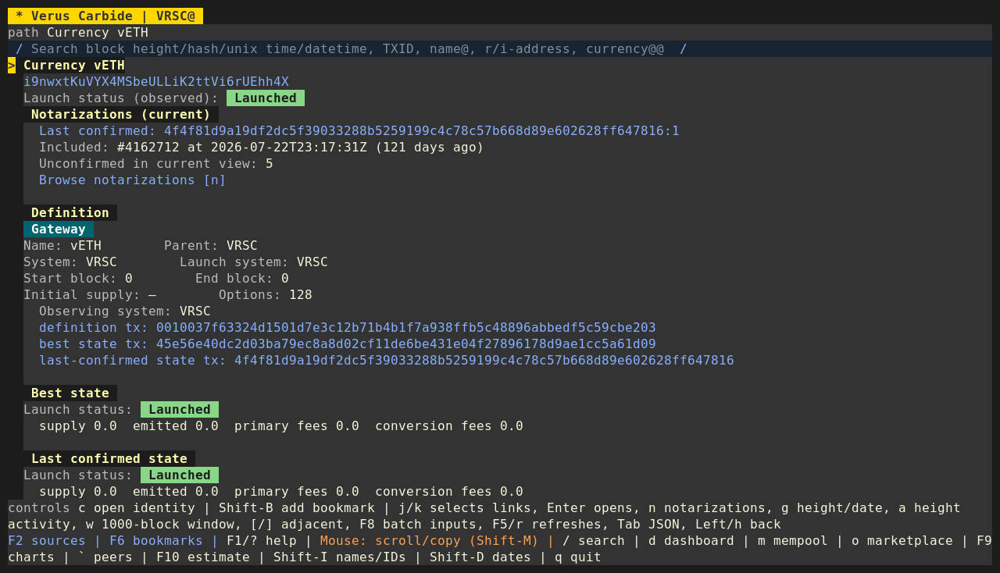
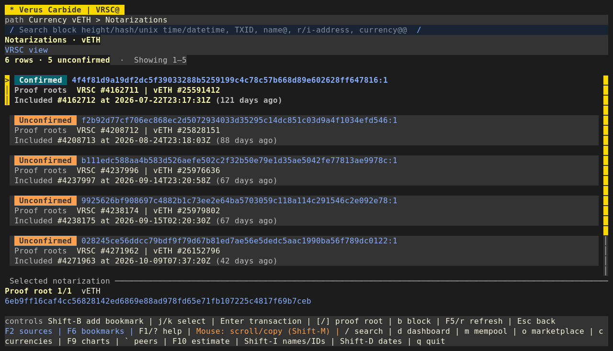
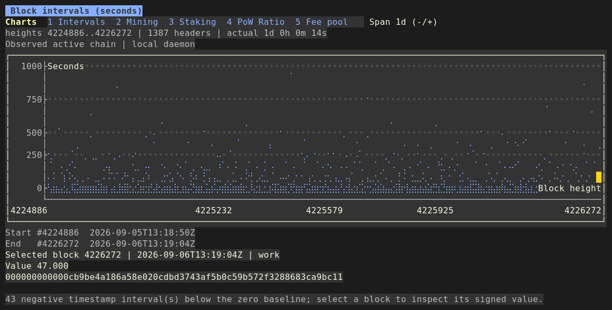

# Verus Carbide

Carbide is a terminal explorer and toolkit for Verus and PBaaS chains. It connects to your local daemon(s). Follow a transaction from its block to a recipient, inspect an identity and its currency, or trace a reserve transfer across chains. Decoded views link to the underlying transactions and RPC data. This does not use any data from the local wallet, though that may be changed in the future. There are no plans to incorporate any actions that create or sign transactions. Carbide was built as a TUI so it could be used on remote systems over ssh to interrogate the local chain data,. This software is experimental and comes with no warranty for any purpose. It has been tested only on Debian 13 so far and only lightly as I've actually been using it. I am not accepting PRs at this time, but issues with suggestions or reports are welcome.



Select **Stream Blocks** to watch new blocks arrive. Move down to keep a particular block selected, or press `Tab` to browse recent transactions. On a narrow terminal, `Tab` switches which list is visible.

## Build and run

Carbide has only been tested on Debian 13.

On a fresh Debian installation, install the native build tools and the tools
needed to fetch the source and install Rust.

```sh
sudo apt update
sudo apt install build-essential ca-certificates curl git
```

Install a stable Rust toolchain with [rustup](https://rust-lang.org/tools/install/)
if you need Rust and Cargo. Carbide requires Rust 1.88 or newer. Open a new shell
after installing rustup so its tools are on your path.

With a running Verus daemon, build and start Carbide from the repository root.

```sh
cargo build --release --locked
./target/release/vcarbide
```

Carbide starts on VRSC and discovers daemon configurations in the standard Verus and PBaaS directories. To open an object immediately, pass the same value you would enter in search. To start on another chain, specify its name.

```sh
./target/release/vcarbide 4226272
./target/release/vcarbide -chain=VRSC 'vETH@@'
```

Use `-testnet` for testnet or `-conf=/path/to/daemon.conf` for a nonstandard daemon configuration. For toolchain and portable build instructions, see the [build notes](BUILD.md).

## Follow a transaction

1. Press `/`, type `4226272`, and press `Enter`. This mined VRSC block contains one transaction. Its tile identifies the input as **Coinbase**.
2. Press `Enter` on the tile. Output 0 pays **3.00046564 VRSC** to a transparent address. Output 1 records the fee pool balance. Only the first is a spendable payment.
3. Select the recipient address and press `Enter` to explore its activity. Press `Esc` to return. From the transaction, `Tab` opens its JSON and `b` opens the containing block.



<details>
<summary>See the containing block and its transaction tile</summary>



</details>

## Search and navigation

Press `/`, enter a value, then press `Enter`. A search opens a new navigation root. Following a link within a view adds it to the breadcrumb path.

| Enter in search | Opens |
| --- | --- |
| `4226272` or a block hash | Block header and transactions |
| A transaction ID | Transaction overview, inputs and outputs |
| `1788700744` or `2026-09-06 13:19:04 UTC` | Block nearest the requested time among the headers checked |
| `2026-09-06` | Block near midnight UTC on that date |
| `vETH@` or its i-address | Identity, authorities, registration and activity |
| `RXPzH3i4fZaaPFdkVHWKRDgXDqrFXErEGz` | Transparent recipient from the walkthrough |
| `vETH@@` | Currency definition and state on the current chain |

Use the arrows or `j`/`k` to select, `Enter` or Right to follow, and `Esc` to close or go back. Press `q` to quit. The footer lists actions for the current view. `F1` or `?` opens Help. In data views, `Shift-I` toggles names and raw identity addresses, and `Shift-D` shows dates for supported heights and timestamps.

## Identities, currencies and notarizations

Open `vETH@` and look for **Currency defined**. Press `c` to switch between the identity and its currency. The identity shows signing authorities, registration evidence and transaction history. The currency shows definition flags, launch status, state and the height and time of its last confirmed notarization.



<details>
<summary>See the associated currency definition</summary>



</details>

Press `n` on the currency to browse confirmed and pending notarizations. The screenshot shows the VRSC perspective on the vETH gateway, with the proof-root heights for both systems and the age of each notarization on VRSC. Open a row with `Enter`, then use `F4` in the transaction to investigate witness signatures.



## Charts and time

Press `F9` to chart block intervals, mining or staking difficulty, PoW Ratio, or fee pool balances. Use `-` and `+` to change the span, `g` to seek by height or time, and `Enter` to inspect the selected block. For a future height or date, use the estimator with `F10`.



## Other places to explore

| From | Action |
| --- | --- |
| Dashboard | `m` opens the mempool. `o` opens marketplace offers and their linked assets and funding transactions. |
| Dashboard | `c` opens the currency browser. It starts with liquidity pools and hides known failed launches. `Shift-F` changes the flag and launch-status filters. |
| Currency | `g` seeks historical state by height or date. `w` browses a 1,000-block activity window for imports and exports. |
| Transaction | `F3` follows protocol links. `F8` traces supported transfers through export batches, imports and result outputs. The trail distinguishes verified receipts from candidates and unresolved results. |
| Supported detail view | `Shift-B` bookmarks the current location, including a notarization browser and its observing chain. `F6` opens bookmarks. |
| JSON view | `Space` expands a node, `y` copies the raw value or subtree, and `s` saves JSON. `Shift-M` switches between app mouse controls and terminal-native selection. |

## Connections, storage and troubleshooting

- **Daemon lookup fails.** Run `./target/release/vcarbide --probe` with the same chain and configuration arguments. In `F2` Sources, check the selected chain, config path and connection status. Enabling a daemon allows requests. Monitoring also polls its tip and mempool.
- **A view has missing history or names.** Some lookups need an index the daemon may lack. Requests prefer the local daemon. An enabled, chain-compatible API can fill gaps. An explicit failed lookup can offer a source-selection prompt. Press `Esc` to cancel or `r` to retry.
- **Cache or settings location.** Help shows the cache path and usage. On Linux, the cache holds `mainnet.sqlite3` and `testnet.sqlite3` under `~/.cache/verus-carbide/`, or `$XDG_CACHE_HOME/verus-carbide/` if set. Settings and bookmarks are stored separately. See the [explorer reference](docs/reference.md).
- **Copying over SSH or tmux.** Run `./target/release/vcarbide --clipboard-test` and paste into another window to check the terminal clipboard path. See the [clipboard configuration guide](docs/reference.md#clipboard-testing-and-tmux).

## Further reading

- [Explorer reference](docs/reference.md) — full key bindings, chart metrics, DeFi tracing, witness evidence and bookmarks.
- [Storage guide](STORAGE.md) — cache ownership, retention, reconciliation and reset behavior.
- [Cross-chain architecture](CROSS_CHAIN_ARCHITECTURE.md) — how chain workspaces, sources and observations relate.

Verus Carbide is licensed under the [MIT License](LICENSE).
