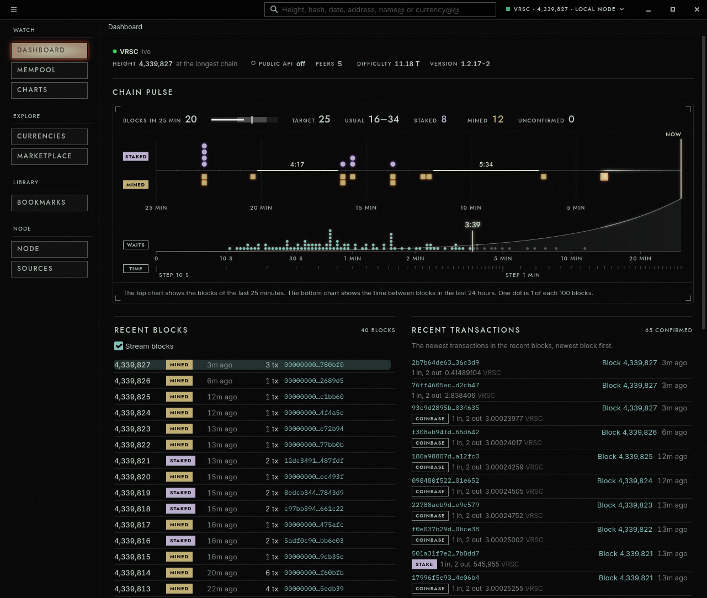
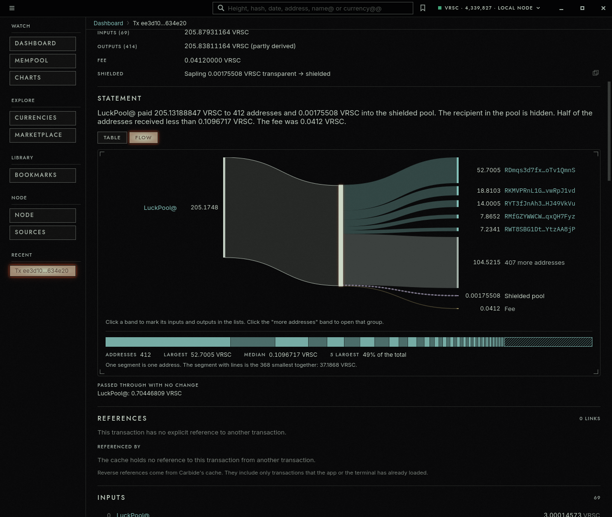

# Carbide Silica for Linux

Carbide Silica for Linux is the Linux version of the Carbide Silica explorer for Verus and PBaaS chains. [Release 0.1.1](https://github.com/aelder/CarbideSilica/releases/tag/linux-v0.1.1) has a `.deb` package and a tarball for x86-64. It has the same pages, the same functions and the same display as the macOS app. It is written in Rust with GTK 4 (gtk4-rs). It calls the same bridge crate as the macOS app, so it uses Carbide's RPC client, decoding and cache. Carbide is the terminal explorer by [alexenglish](https://github.com/alexenglish).

The app is read-only. It does not read a wallet, and it cannot create, sign or send a transaction.





The pictures are from the app in a container with a live VRSC node. [docs/progress](docs/progress) has a picture of each page.

## Requirements

- GTK 4.14 or later. The app uses the `v4_14` features of gtk4-rs.
- ALSA (`libasound2`) for the interface sounds. PipeWire and PulseAudio serve ALSA.
- fontconfig.
- The CA certificates of the system (`ca-certificates`). The HTTP client of the app loads them at start, also for a local node.
- A Verus node with its RPC port open to this computer, for live chain data.
- Python 3, for the demo.

The `.deb` package is built and tested on Debian 13 (trixie), which has GTK 4.18. Its `Depends` list asks for glibc 2.38 or later and GTK 4.13.5 or later. The package was not tested on other distributions. If the package does not install, build the app from source.

The app brings its own fonts. For emoji and for Chinese, Japanese, Korean and Arabic names, install the Noto fonts of the system. On Debian and Ubuntu, these are `fonts-noto-color-emoji`, `fonts-noto-cjk` and `fonts-noto-core`. On Fedora, these are `google-noto-color-emoji-fonts` and `google-noto-sans-cjk-fonts`. Without them, those names show as boxes.

## Install

### Debian package

```sh
sudo apt install ./carbide-silica_0.1.1_amd64.deb
```

Use the file name of your architecture. apt installs the libraries in the `Depends` list of the package. The package puts the binary in `/usr/bin`, the fonts and sounds in `/usr/share/carbide-silica`, and the desktop file, the AppStream file and the icons in `/usr/share`. The app then shows in the application menu of the desktop.

To remove the app:

```sh
sudo apt remove carbide-silica
```

### Tarball

The tarball has `bin/`, `share/`, `install.sh` and `uninstall.sh`. The scripts install to a prefix. The default prefix is `~/.local`.

```sh
tar -xzf carbide-silica-0.1.1-linux-x86_64.tar.gz
cd carbide-silica-0.1.1-linux-x86_64
./install.sh            # into ~/.local
./install.sh /opt/carbide-silica
```

`install.sh` writes the full path of the binary into the desktop file. It writes the list of the installed files into `<prefix>/share/carbide-silica/installed-files`. `uninstall.sh` uses that list:

```sh
./uninstall.sh          # from ~/.local
./uninstall.sh /opt/carbide-silica
```

The tarball does not install the libraries. Install GTK 4, ALSA, fontconfig and the CA certificates with the package manager of your distribution.

### Demo

The two packages include a demo command. The demo starts the app with a local RPC server that supplies a synthetic chain. It does not need a Verus node.

```sh
carbide-silica-demo --open 5000
```

After a tarball install into the default prefix, the command is `~/.local/bin/carbide-silica-demo`. The application menu also has the action **Run Synthetic Demo** on the Carbide Silica entry. `--open 5000` opens the tip block at start.

When you close the window, the demo stops its server and removes its temporary settings and cache. The command `carbide-silica` opens the app with your usual node settings.

### Flatpak, AppImage and Snap

These packages do not exist yet. Their tools are not in the Debian repositories, and the build uses only Debian packages.

## Build

### With Docker

The build runs in a Debian 13 container. The cargo registry and the target folder are the Docker volumes `carbide-linux-cargo` and `carbide-linux-target`. The build writes nothing into the source tree, except the packages in `linux/dist/`.

```sh
cd linux
./build.sh              # debug build
./build.sh test         # unit tests
./build.sh release      # release build, /target/release/carbide-silica in the volume
./package.sh            # release build, .deb and .tar.gz in linux/dist/
./package.sh verify     # installs the .deb in a clean container and takes a picture
./package.sh verify-tar # installs the tarball in a clean container and takes a picture
```

The packages are for the architecture of the Docker host. On an aarch64 host, the package is `arm64`. On an x86_64 host, the package is `amd64`.

### Without Docker

Install Rust 1.88 or later. Install the development packages of GTK 4, ALSA and fontconfig. On Debian 13:

```sh
sudo apt install build-essential pkg-config libgtk-4-dev libasound2-dev libfontconfig-dev
```

Then build from the `linux` folder:

```sh
cd linux
cargo build --release
./target/release/carbide-silica
```

A binary in the source tree finds its fonts and sounds in `linux/resources`. An installed binary finds them in `<prefix>/share/carbide-silica`, where `<prefix>` is the folder above the folder of the binary. The variable `CARBIDE_SILICA_RESOURCES` names a different folder.

## Synthetic data

After a debug build, run the demo from the repository root:

```sh
python3 tests/synthetic_demo.py
```

The demo starts the app and an RPC server on a free loopback port. The chain has these properties:

- The tip is fixed at height 5,000.
- Each block has one coinbase transaction.
- The node has one peer and an empty mempool.

The server makes each block when the app asks for it. The Dashboard, the Charts page, the block and transaction pages and the Node page work with this chain. Other RPC methods give an error. The demo uses temporary folders for the settings and the cache, and removes them when you close the window.

`--open 5000` opens the tip block at start. `--binary PATH` uses a different build.

## Connect to a node

The app reads the RPC settings from the node configuration file. These are the standard locations on Linux:

| Chain | File |
|---|---|
| VRSC | `~/.komodo/VRSC/VRSC.conf` |
| VRSC testnet | `~/.komodo/vrsctest/vrsctest.conf` |
| A PBaaS chain | `~/.verus/pbaas/<chain ID>/<chain ID>.conf` |
| A PBaaS chain on the testnet | `~/.verustest/pbaas/<chain ID>/<chain ID>.conf` |

The chain menu in the title bar lists the chains that have a file in these locations.

To use a different file, select it in Settings (Ctrl+,), or start the app with `-conf=`. The start-up arguments are the same as on macOS and in Carbide: `-chain=`, `-testnet`, `-conf=`, `-datadir=`, `-rpcconnect=`, `-rpcport=`, `-rpcuser=`, `-rpcpassword=`, `-pollinterval=` and `-open=`. The arguments apply to one run.

```sh
carbide-silica -conf=/srv/verus/VRSC.conf -open=vETH@
```

The app keeps its files in these places:

| File | Location |
|---|---|
| Settings of the app | `~/.config/carbide-silica/settings.json` |
| Settings and bookmarks shared with Carbide | `~/.config/verus-explorer-tui/config.toml` |
| Cache shared with Carbide | `~/.cache/verus-carbide` |

The public API is off at the start, as on macOS.

## Keys

The shortcuts of the macOS app have these Linux keys:

| macOS | Linux |
|---|---|
| Command | Ctrl |
| Option | Alt |
| Shift | Shift |
| Control-Command (the Investigate menu) | Ctrl+Shift |

For example, ⌘K is Ctrl+K, ⌥⌘S is Ctrl+Alt+S and ⌃⌘T is Ctrl+Shift+T. Ctrl+/ shows all shortcuts. The terminal keys (`j`, `k`, Return, Esc, Tab, `/`, `n`, `p`, F1 to F10 and the others) are the same as on macOS.

GTK 4 has no menu bar in this window. The menus of the macOS menu bar (View, Go, Investigate, Peers, Bookmark, Keyboard Shortcuts, Settings and Quit) are in the menu key at the left of the title bar. Each item shows its Linux shortcut.

## Differences from macOS

- Fonts: Jost replaces Futura. Inter replaces the system face (SF Pro). IBM Plex Mono replaces SF Mono. The three fonts are under the SIL Open Font License 1.1. They are in the package, and the app gives them to fontconfig at start. The app does not install them on the system.
- Menus are in the menu key of the title bar.
- The window buttons follow the layout of the desktop.
- Some words name Linux things. "Show in Files" replaces "Show in Finder". Settings says "this computer" in place of "this Mac".
- Sounds play through ALSA.

[PORT.md](PORT.md) lists each difference for the engineers who change the app.

## Known limits

- The page tests ran in a Docker container on aarch64 (Debian 13), on Xvfb, with no window manager. The x86-64 release ran on a Linux desktop.
- The container has no audio device and no GPU. The container tests did not cover the sounds, GPU rendering, the fades of the lamp keys or Wayland.
- The release has packages for x86-64 only. For aarch64, build the packages with `./package.sh`.
- The `.deb` package was tested only on Debian 13.
- The demo supplies only the Dashboard, the Charts page, the block and transaction pages and the Node page.
- Ctrl+Alt+L (the mempool list) can be the lock-screen key of the desktop.
- Flatpak, AppImage and Snap packages do not exist yet.

## License

Carbide Silica has the MIT License, as Carbide. Jost, Inter and IBM Plex Mono are under the SIL Open Font License 1.1. Their licence files are in `resources/fonts`. The interface sounds are under the MIT License. `resources/sounds/LICENSE-button-sounds.txt` has the notice.
